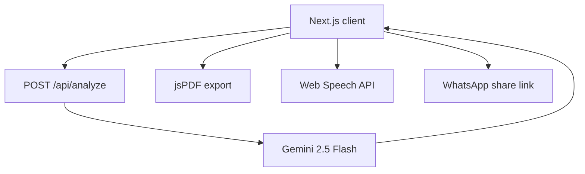

# FormSarathi — Technical Documentation (CodeQuest Final Showcase)

## System overview

FormSarathi is a serverless civic-document assistant. Users upload a form image/PDF or pick a curated sample. The backend sends the file to **Google Gemini 2.5 Flash** for multimodal extraction and returns structured JSON: explanations (English + Hindi), checklist, pitfalls, and draft fields. The browser renders tabs, supports **read-aloud**, **WhatsApp checklist sharing**, **editable drafts with PDF export**, and a **Rejection Guard** tab that compares draft names against reference ID values using deterministic string matching.

**Privacy:** uploads are processed in memory on the server; no database or persistent file storage.



## Tech stack

| Layer | Technology |
|-------|------------|
| Frontend | Next.js 16 App Router, React 19, TypeScript, Tailwind CSS |
| Backend | Next.js Route Handlers (`src/app/api/analyze/route.ts`) |
| AI | `@google/generative-ai`, model `gemini-2.5-flash` (env `GEMINI_MODEL` optional) |
| PDF | `jspdf` (client-side; English/Latin labels) |
| Hosting | Vercel |
| CI | GitHub Actions (`npm run lint`, `npm run build`) |

## API: `POST /api/verify`

Multipart: `idFile` (image, max 8 MB), `draftName` (string).

1. Gemini 2.5 Flash extracts `fullName` from the ID image (`src/lib/gemini-id.ts`).
2. `compareNames()` in `src/lib/match.ts` returns `match` / `typo` / `mismatch` (deterministic).

## API: `POST /api/analyze`

### Sample mode (JSON)

```http
POST /api/analyze
Content-Type: application/json

{"sampleId":"scholarship"}
```

Returns cached analysis from `src/data/samples.ts` with `source: "sample"`.

### Upload mode (multipart)

```http
POST /api/analyze
Content-Type: multipart/form-data

file=<image or PDF, max 8 MB>
```

Flow:

1. Validate MIME (`image/*` or `application/pdf`) and size.
2. Read buffer; base64-encode for Gemini inline data.
3. Prompt demands strict JSON matching `FormAnalysis` shape (`src/types/form.ts`).
4. **Zod** validation via `src/lib/analysis-schema.ts`; **one automatic retry** on invalid JSON.
5. **Unit tests** for deterministic name matching (`src/lib/match.test.ts`, `npm test` in CI).
5. Fields may include `confidence` and `sourceText` from the model (defaults applied when missing).

Errors: `400` invalid file, `503` missing `GEMINI_API_KEY`, `500` model/parse failure (message surfaced to UI).

## Integrations

| Service | Purpose | Configuration |
|---------|---------|----------------|
| Google Generative AI | Vision + structured extraction | `GEMINI_API_KEY` on Vercel |
| Web Speech API | Read-aloud (hi-IN / en-IN) | Browser only; no key |
| WhatsApp | Share checklist via `wa.me` | Client-generated link |

## Enhanced features (Final round)

1. **Editable draft PDF** — React state drives field values; export uses edited values.
2. **Rejection Guard** — `src/lib/match.ts` normalizes names and uses Levenshtein distance; Verify tab updates when draft fields change.
3. **Accessibility** — Read aloud on summary; bilingual UI.
4. **Share checklist** — WhatsApp + clipboard for family/cyber café helpers.
5. **Official portal links** — Sample analyses include `portalUrl` (e.g. scholarships.gov.in).
6. **Privacy UX** — Clear results control; no server-side storage documented in UI.

## Repository layout

```
src/
  app/api/analyze/route.ts   # Analyze endpoint
  components/                # UI
  data/samples.ts            # Seeded demos
  lib/gemini.ts              # Gemini client
  lib/export-pdf.ts          # PDF download
  lib/match.ts               # Name comparison
  lib/speech.ts              # TTS
  lib/share-checklist.ts     # WhatsApp / copy
  types/form.ts              # Shared types
docs/TECHNICAL.md            # This file
```

## Local development

```bash
npm install
cp .env.example .env.local   # add GEMINI_API_KEY
npm run dev
```

## Disclosure

AI tools assisted development and live extraction. Architecture, matcher logic, samples, and problem framing are original. No secrets are committed to Git.